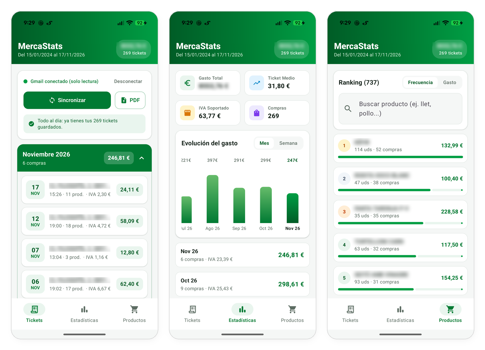

  

<h1 align="center">MercaStats</h1>

  

  En la página que se abre, baja hasta <b>Assets</b> y pulsa el archivo <code>.apk</code> para descargarlo e instalarlo en tu móvil Android.

  

Aplicación Android (Kotlin + Jetpack Compose) que lee los tickets digitales PDF de Mercadona desde tu correo por IMAP (Gmail, iCloud u otro proveedor) o mediante importación directa de archivos PDF. Los guarda en una base de datos SQLite local evitando duplicados y muestra estadísticas de gasto semanal, mensual y por producto.

  

---

## Novedades de la versión 1.2.0

- **Los tickets del correo se importan ahora por IMAP.** Hasta ahora la importación automática usaba el inicio de sesión de Google, que exigía que el autor diera de alta tu Gmail como «usuario de prueba» en Google Cloud y solo servía para Gmail. Con IMAP basta una **contraseña de aplicación** de tu correo: funciona con Gmail, iCloud y otros proveedores, sin pedir permiso a nadie. Ver [Correo por IMAP](#correo-por-imap).
- **Histórico de precios por producto:** en la pestaña **Productos**, pulsa un producto para ver una gráfica de cómo ha cambiado su precio (por unidad, o por kg si se vende a peso), con el último precio, el mínimo, el máximo, la variación y la lista de compras.
- **La importación sigue con la pantalla apagada:** corre en segundo plano con una notificación de progreso, y si se corta la conexión vuelve a conectar sola.
- **Ayuda en la propia app** para crear la contraseña de aplicación de Gmail e iCloud, con un botón a la página donde se crea.
- **Las cuentas de Outlook y Hotmail no son compatibles**, porque Microsoft ya no admite IMAP con contraseña en las cuentas personales. La app lo avisa al escribir un correo de ese tipo.
- **Se elimina el inicio de sesión con Google.** Si lo usabas, conecta tu correo por IMAP desde **Conectar correo**.
- **Hay que desinstalar la versión anterior.** La 1.2.0 va firmada con otra clave y no se instala encima de la 1.1.3. Al desinstalarla se borran los tickets guardados: conecta tu correo por IMAP (o vuelve a importar los PDF) y se recuperan. A partir de aquí, las siguientes versiones se instalarán encima sin problema.

---

## Características

- **Correo por IMAP:** Conecta tu correo con una **contraseña de aplicación** y elige la carpeta o etiqueta donde guardas los tickets. Funciona con Gmail, iCloud y cualquier correo con IMAP, salvo Outlook/Hotmail. Descarga solo los correos nuevos y sigue en segundo plano aunque apagues la pantalla. Ver [Correo por IMAP](#correo-por-imap).
- **Importación manual de PDFs (100% offline):** Si prefieres no conectar ningún correo, puedes descargar los PDFs y cargarlos directamente desde el almacenamiento del móvil, o compartirlos con la app desde otra aplicación.
- **Sincronización automática al abrir la app:** Tras conectar tu correo, busca los tickets nuevos cada vez que abres la app.
- **Parser PDF offline:** Extrae tienda, dirección, fecha/hora, número de factura simplificada, líneas de producto (unidades y peso) y desglose de IVA usando `pdfbox-android`, sin OCR ni servicios externos.
- **Base de datos SQLite local:** Almacena tickets, productos e IVA evitando duplicados por número de ticket, hash SHA-256 del PDF e identificador del correo.
- **Estadísticas y visualización:**
  - Tickets agrupados por mes desplegable con total mensual y diálogo de detalle individual.
  - Gráfica de barras con desglose de gasto por mes y por semana.
  - Ranking de productos por frecuencia de compra y gasto acumulado con buscador y medallas Top 3.
  - Histórico de precios de cada producto: al pulsarlo, gráfica de evolución (se puede tocar cada punto), último precio, mínimo, máximo, variación y compras con la subida o bajada respecto a la anterior.

---

## Correo por IMAP

Es la forma de importar los tickets automáticamente desde la versión 1.2.0: sirve para cualquier correo con IMAP y no necesita cuenta de Google Cloud.

1. Crea una **contraseña de aplicación** en tu cuenta de correo (no es tu contraseña normal):
   - **Gmail:** necesitas tener activada la verificación en dos pasos. Entra en [myaccount.google.com/apppasswords](https://myaccount.google.com/apppasswords), crea una llamada `MercaStats` y copia los 16 caracteres.
   - **iCloud:** en [account.apple.com](https://account.apple.com), **Inicio de sesión y seguridad** → **Contraseñas específicas de la app** → genera una nueva.
   - **Outlook / Hotmail / Live:** no funcionan. Desde septiembre de 2024 Microsoft no admite IMAP con contraseña (ni con contraseña de aplicación) en las cuentas personales, solo con inicio de sesión OAuth. Reenvía los tickets a otro correo o comparte los PDF con la app.
   - **Otros proveedores:** busca «contraseña de aplicación» o «IMAP» en la ayuda de tu correo.

   La propia app explica estos pasos al elegir Gmail o iCloud, con un botón que abre la página donde se crea la contraseña.
2. En la app, en la pestaña **Tickets**, pulsa **Conectar correo**.
3. Escribe tu correo y la contraseña de aplicación. Para Gmail e iCloud el servidor se rellena solo; si usas otro, escribe su servidor IMAP (por ejemplo, `imap.ejemplo.com`).
4. En **Carpeta o etiqueta**, deja `INBOX` (la bandeja de entrada) o escribe la carpeta donde guardas los tickets. Las etiquetas de Gmail se escriben con su nombre, y si están dentro de otra con `/` (por ejemplo, `Tickets/Mercadona`). La etiqueta tiene que tener activado **«Mostrar en IMAP»** en la configuración de Gmail. Si la carpeta no existe, la app te dice cuáles hay.
5. Pulsa **Guardar y sincronizar**. La app comprueba la conexión, guarda los datos y descarga los tickets.

La importación sigue aunque se apague la pantalla o salgas de la app: corre en segundo plano con una notificación de progreso, y si se corta la conexión vuelve a conectar sola.

A partir de ahí, **Sincronizar** y la sincronización al abrir la app usan esta cuenta. Para cambiarla o borrarla, pulsa **Ajustes** junto a tu correo (**Olvidar esta cuenta** borra los datos de acceso; tus tickets se conservan).

La app solo **lee** los correos de `ticket_digital@mail.mercadona.com`: no borra, mueve ni marca nada. La contraseña de aplicación se guarda **solo en el móvil y cifrada** con una clave del almacén seguro de Android (Keystore), y no se incluye en copias de seguridad.

---

## Privacidad

Todos los tickets, productos y estadísticas se procesan y almacenan exclusivamente en el dispositivo del usuario (base de datos SQLite local). La aplicación no cuenta con servidores intermediarios ni envía tus datos o tickets a terceros. Para leer el correo, la app se conecta directamente con tu servidor de correo (siempre cifrado con TLS) y la contraseña de aplicación se guarda cifrada en el propio móvil.

---

## Arquitectura y detalles técnicos

- **Base de datos (`data/TicketDatabaseHelper.kt`):** SQLite (`mercadona_tickets.db`, versión 2) con tablas `tickets` (cabecera, `total_amount`, `total_vat_amount`, `ticket_number`, `pdf_sha256`, `gmail_message_id`), `ticket_items` (`quantity`, `unit`, `description`, `unit_price`, `total_price`), `ticket_vat` e `imap_seen_messages` (correos IMAP ya revisados).
- **Parser (`parser/MercadonaTicketParser.kt`):** Extrae la cabecera y las líneas entre `Cnt./Cant.` y `TOTAL (€)` soportando castellano y catalán, unidades (`ITEM_LINE_WITH_UNIT_PRICE`, `ITEM_LINE_SINGLE`) y productos al peso (`WEIGHT_LINE_REGEX`, asociando la descripción de la línea anterior).
- **Cálculo de estadísticas (`stats/StatsCalculator.kt`):**
  - El **Gasto Total** y las gráficas mensuales/semanales suman el `total_amount` oficial de cada ticket (`TOTAL (€)`).
  - **Ranking de productos (`productStats`):** Agrupa `ticket_items` normalizando `description` (`trim`, espacios colapsados, `uppercase(Locale.ROOT)`) y acumula `totalQuantity` (unidades o `kg`), `purchaseCount` (nº de tickets distintos en los que aparece) y `totalAmount` (€).
- **Correo IMAP (`mail/`):** `ImapMercadonaService` (conexión TLS en solo lectura con Jakarta Mail), `ImapMessageParts` (extracción de PDFs e identificador estable de cada correo) e `ImapSettingsStore` (cuenta guardada, contraseña cifrada con Android Keystore).
- **Sincronización en segundo plano (`sync/`):** `ImapSyncService` (servicio en primer plano con notificación de progreso), `ImapTicketImporter` (importación con reconexión automática) e `ImapSyncBus` (estado que observa la pantalla).
- **Interfaz (`ui/MercadonaAppUi.kt`):** Tres pestañas inferiores:
  1. `Tickets`: sincronización IMAP / importación PDF y listado.
  2. `Estadísticas`: KPIs globales y gráficas por mes / semana.
  3. `Productos`: alterna entre **Más comprados** (`purchaseCount` → `totalQuantity` → `totalAmount`) y **Mayor importe** (`totalAmount`), con buscador por nombre y barra proporcional. Al pulsar un producto se abre `ProductPriceDialog` con su histórico de precios (`priceHistory`).

Consulta [docs/ARCHITECTURE.md](docs/ARCHITECTURE.md) para más detalles sobre la arquitectura interna y la guía de compilación. Si trabajas con un agente de código (Claude Code, Codex, Antigravity…), las instrucciones del proyecto están en [AGENTS.md](AGENTS.md).

---

## Licencia

Copyright © 2026 [neoruben](https://github.com/neoruben). Todos los derechos reservados.

El código fuente de este proyecto se publica exclusivamente con fines educativos y de consulta personal. Queda terminantemente prohibida la redistribución, modificación, venta, uso comercial o publicación de este software (en formato fuente o binario compilado/APK) en cualquier plataforma o tienda de aplicaciones (incluyendo Google Play Store u otras tiendas de terceros) sin la autorización expresa y por escrito del autor.

---

Si te gusta el proyecto o te resulta de utilidad, puedes apoyar su desarrollo invitándome a un café en [Ko-fi](https://ko-fi.com/neoruben).
